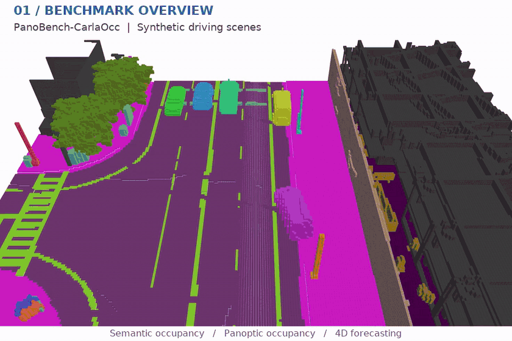
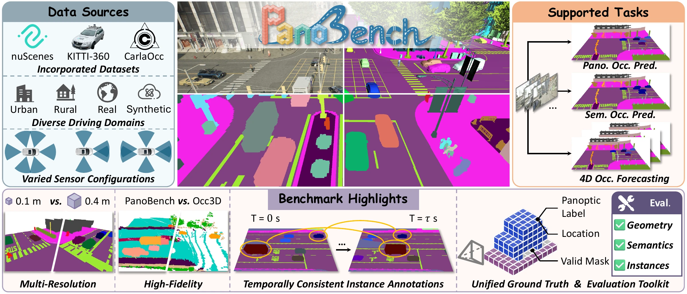

<div align="center">


<h2>A Panoptic Occupancy Prediction Benchmark<br>for Autonomous Driving</h2>

<p>
  <a href="https://mias.group/PanoBench/"></a>
  <a href="https://arxiv.org/abs/2610.23537"></a>
  <a href="https://huggingface.co/datasets/fengyi233/PanoBench"></a>
  <a href="https://www.bilibili.com/video/BV1aUJR6oEHT/"></a>
</p>

<p><strong>200K+ frames &nbsp; · &nbsp; ~1K sequences &nbsp; · &nbsp; 3 subsets</strong><br>
Voxel resolutions: <strong>0.1 / 0.2 / 0.4 m</strong></p>


</div>

<p align="center">
  
</p>


## Overview

<p align="center">
  
</p>

**PanoBench** is a camera-centric benchmark for panoptic occupancy prediction. It brings together synthetic and real-world driving scenes in a shared representation of 3D geometry, semantic categories, and object identities.

### Three complementary datasets

- **PanoBench-CarlaOcc** — synthetic driving scenes from CARLA, with complete mesh-derived geometry.
- **PanoBench-nuScenes** — real-world surround-view scenes with complete foreground annotations.
- **PanoBench-KITTI360** — real-world forward-view driving sequences with persistent instance identities.

### One benchmark, three tasks

**Semantic occupancy prediction** · **Panoptic occupancy prediction** · **4D occupancy forecasting**

Complete foreground geometry, temporally consistent instance identities, and a shared valid-mask protocol support evaluation across the three domains. See the [project page](https://mias.group/PanoBench/) for dataset videos, annotation comparisons, and benchmark results.

## Release status

- [x] Paper and project page
- [ ] Training and evaluation code
- [ ] Pretrained weights

Code will be released first. Dataset annotations and pretrained weights will follow as they become available.

## Citation

```bibtex
@article{feng2026panobench,
  title={PanoBench: A Panoptic Occupancy Prediction Benchmark for Autonomous Driving},
  author={Feng, Yi and Guo, Zizhan and E, Junwu and Ma, Yu and Zhang, Mengtan and Wu, Jin and Ye, Wei and Wang, Hanli and Chen, Qijun and Wang, Danwei and Fan, Rui},
  journal={arXiv preprint arXiv:2610.23537},
  year={2026}
}
```

## License

Original PanoBench code is released under the [MIT License](LICENSE). Third-party components retain their respective licenses.
